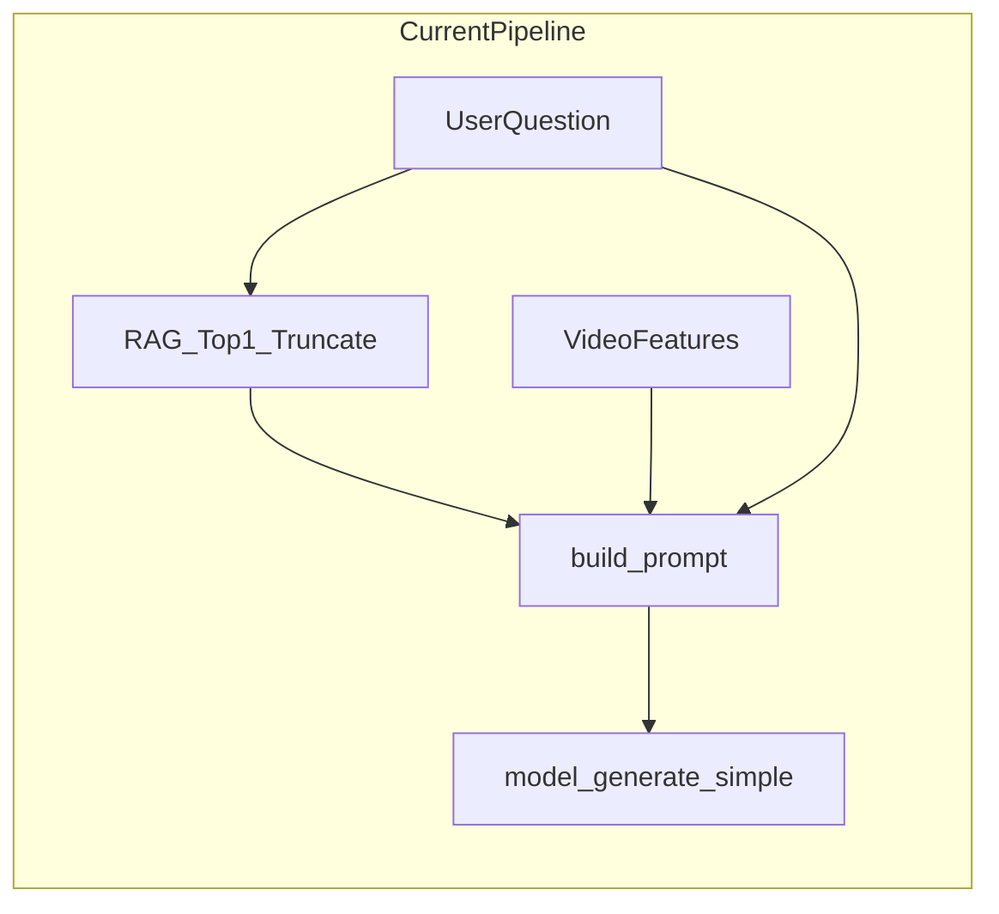

# 推理阶段（生成）准确率优化：调研报告

本文档面向 **X-VARS + RAG** 原型：在固定测试集（约 300 条）上以 **准确率** 为主目标，对提示词工程、Knowledge RAG、CoT、Self-consistency、PageIndex 等方向的 **工作量** 与 **预期收益** 做对比，并给出可落地的实施顺序。实际增益依赖标签形式（二分类 / 多分类 / 开放式）与错误分布，**实施前应做一次小规模错误归因**。

---

## 1. 背景与当前系统摘要

### 1.1 数据流

系统路径（与仓库实现对齐）：用户问题 `question` → 可选 RAG 检索 → 拼接为 `enhanced_question` → `build_prompt`（融合视频占位与对话模板）→ `model_generate_simple` 解码。

当前主流水线实现文件：[x_vars_demo_with_streamlit.py](../x_vars_demo_with_streamlit.py)（仓库根目录；若使用 [src/streamlit_app.py](../src/streamlit_app.py) 副本，请以对齐的那一份为准）。

### 1.2 RAG 与生成参数（现状要点）

- **RAG**：`FootballRAGSystem.search(question, top_k=3)`，但实现上 **仅使用检索结果 Top1**；规则文本 **截断约 200 字符** 后以「参考规则：…」形式拼入问题。
- **生成**：典型默认包括 `max_new_tokens=64`、`do_sample=False`、`video_token_len` 可配等；过长指令或过长 CoT 会与 **视频 token 预算** 竞争。

### 1.3 示意流程图

---

## 2. 评测设定建议（300 样本）

| 项目 | 建议 |
|------|------|
| **主指标** | 准确率（与任务一致：如犯规/不犯规、出牌类别、或标准化后的选项匹配） |
| **数据划分** | 训练/提示微调若有需要，须与测试 300 条 **严格隔离**；避免 few-shot 泄漏 |
| **辅助指标（可选）** | 检索片段是否含正确条款（规则命中率）、答案可解析性、长度；开放式可辅以 BLEU/ROUGE **在有人类参考时** |
| **消融报告** | 至少记录：`use_rag`、`top_k`、是否截断、是否重排、`max_new_tokens`、是否 CoT / 是否 self-consistency，便于论文复现 |

---

## 3. 调研维度说明（阅读下表前）

对每种方法从下列 **四个维度** 评估（正文第 4、5 节已内化）。

1. **与失败模式的匹配度**：错误来自检索、上下文不足、输出无法对齐规范、还是视觉侧误判。
2. **实现工作量**：仅改模板 / 改检索管线 / 多次 LLM 调用 / 外部服务与新索引。
3. **对 300 样本准确率的预期 uplift**：定性 **低 / 中 / 高**（附带依赖条件）。
4. **副作用**：延迟、费用、评测解析复杂度、可复现性。

---

## 4. 各方法详解（原理 → 接合点 → 工作量 → 收益与风险）

### 4.1 Knowledge RAG（深化）

- **原理**：在生成前注入与问题相关的规则文本，减轻幻觉、提高与竞赛规则的一致性。
- **与本项目接合点**：`generate_answer` 中 `enhanced_question` 构造；`FootballRAGSystem` 的切分、嵌入、检索逻辑。
- **工作量**：**中**（视改动范围）。可能包括：按条款/章节重切分、元数据（条款编号）、Top-K 拼接策略、检索后 **重排**、查询 **改写 / HyDE**、缓存与重建索引。
- **准确率潜力**：在「当前仅用 Top1 + 短截断」前提下，若错误多见于 **漏引规则、引错条款**，潜力为 **高**。
- **风险与副作用**：检索噪声会误导模型；片段过长会挤压视频与指令 token；需监控延迟（嵌入与可选 rerank）。

### 4.2 提示词工程（Prompt Engineering）

- **原理**：通过角色、任务说明、输出格式约束（如「先给出判决标签，再一句话依据」）提高 **可解析性** 与 **稳定性**。
- **接合点**：`enhanced_question` 字符串模板、`build_prompt` 前后文案（若可配置）。
- **工作量**：**低**。
- **准确率潜力**：**中**（基线弱时收益更明显；格式与评测脚本强一致时收益稳定）。
- **风险**：指令过长占用上下文；过度复杂模板可能损害多模态对齐较弱的模型。

### 4.3 CoT（Chain-of-Thought，链式思考）

- **原理**：显式要求分步推理再给出结论，以改善逻辑一致性。
- **接合点**：在文本侧加入「逐步分析」要求；通常需提高 `max_new_tokens`；评测需 **从输出中抽取最终标签**（正则/关键词/二次解析）。
- **工作量**：**中**（模板 + 解码参数 + 评测解析）。
- **准确率潜力**：**中（任务依赖）**；对结构化判罚链可能有帮助。
- **风险**：`max_new_tokens=64` 易 **截断** CoT；小模型 **虚构推理链**；延迟与长度上升。

### 4.4 Self-consistency（自洽 / 多样本投票）

- **原理**：对同一输入多次采样生成，对 **离散标签** 做投票或一致性聚合，降低单次随机误差。
- **接合点**：对 `model_generate_simple` 做 `N` 次调用（`do_sample=True`、调节 temperature）；需统一抽取标签的规则。
- **工作量**：**中–高**（工程实现中等，**算力与评测成本**随 N 线性上升）。
- **准确率潜力**：对 **可投票标签** 常为 **中–高**；对长开放式文本 **聚合难**，潜力不确定。
- **风险**：延迟约为 **N 倍**；若不固定随机种子，复现需记录种子与 N。

### 4.5 PageIndex（树索引 / 长文档导航类 RAG）

- **原理**（概念层）：相对「纯向量切块」，用 **文档结构 / 树形导航** 组织长文档，检索更像“翻到相关章节”，减轻切块破坏表格与引用的问题。部分产品化方案会引入 **额外 LLM 调用** 或 **外部索引服务**（如云端构建树索引、MCP/SDK）。

- **接合点**：替换或并联现有 `FootballRAGSystem` 的检索入口；适合 **单份或少量超长规则文档**。

- **工作量**：**高**（索引构建管线、服务依赖、与本地 Streamlit 流程集成）。

- **准确率潜力**：**视库规模与失败模式而定**——长文档、强目录结构、向量检索系统性失败时 **高潜力**；规则库中等规模且问题在语义匹配时，**优先做扎实向量 RAG + 重排** 往往更划算。

- **风险**：供应商锁定、费用、隐私与离线可复现性。

---

## 5. 其他可选方向（简表）

| 方向 | 工作量 | 准确率潜力 | 说明 |
|------|--------|------------|------|
| **Cross-encoder / 小模型 Rerank** | 中 | 中–高 | 在向量召回后用交互式模型对「问题–片段」重打分，常显著减少 **选错条** |
| **HyDE / 多查询扩展** | 中 | 中 | 缓解用户问法与规则术语 **词汇鸿沟** |
| **Few-shot** | 中低 | 中 | 使用与测试集 **隔离** 的示例；注意长度与泄漏 |
| **两阶段：轻量分类 + VLM 解释** | 高 | 视瓶颈 | 若主指标是 **离散判罚**，分类头或专用分类模型可能上限更高，VLM 负责解释 |

---

## 6. 综合排序（准确率优先 + 延迟备注）

以下顺序为 **常见性价比**：先试 **低成本 + 高匹配你现状的短板**（尤其是 RAG 仅用 Top1 + 短截断）。

| 优先级 | 方向 | 工作量 | 准确率潜力 | 延迟/成本 |
|--------|------|--------|------------|-----------|
| 1 | **Knowledge RAG 深化** | 中 | **高**（检索/覆盖为主要短板时） | 检索+rerk 略增；可控 |
| 2 | **提示词工程** | **低** | 中 | 极低 |
| 3 | **CoT** | 中 | 中（任务依赖） | **随 token 增加** |
| 4 | **Self-consistency** | 中–高 | 中–高（离散标签友好） | **约 N 倍** |
| 5 | **PageIndex** | **高** | 视文档形态 | 依赖方案，常 **额外调用/服务** |

**重要提醒**：若错误主要来自 **视频理解**（看错动作），单靠文本 RAG/提示词上限有限，需结合视觉侧更强表征、更多帧、或两阶段判别。

---

## 7. 错误类型 → 推荐技术（对照表）

下表用于 **错误归因之后** 快速选型；无需预先有日志也可作为桌面推演参考。建议抽 **50–100 条** 错例打标下列类型之一（可多选）。

| 错误类型（示例） | 典型现象 | 优先尝试 | 次选/组合 |
|------------------|----------|----------|-----------|
| **检索失败 / 召回为空** | 未命中相关条款或相关性分数长期偏低 | 查询改写、同义词表、HyDE、多查询 | 调整切分粒度、扩大索引字段 |
| **检索到错误条款** | 有规则但不相关或条文 A 与场景 B 混淆 | **Rerank**、缩小切块 + 元数据、Top-K 再过滤 | 规则库清洗、章节标签 |
| **上下文过短** | 模型瞎编或理由与规则脱节 | **取消或放宽 200 字截断**、多片段拼接（控制总长） | Prompt 要求「仅根据参考规则」 |
| **输出格式不稳定** | 评测脚本解析失败、标签漂移 | **Prompt 固定格式**、少量 few-shot | 后处理或抽取模型 |
| **推理跳跃** | 结论与视频描述不一致 | **CoT**（适度）、提高 `max_new_tokens` | Self-consistency（离散标签） |
| **随机波动大** | 同一输入多次结果不一 | `do_sample=False` 或 **降低 temperature**；若需采样则用 **Self-consistency** | 固定随机种子 |
| **长文档结构性引用** | 跨章节、表格、脚注类问题 | **PageIndex 类结构索引**（在确认向量方案不足后） | 人工结构化规则 JSON |
| **视觉误判** | 明显看错是否犯规/身体接触 | 帧采样与特征、两阶段分类、更强 VLM（工作量大） | 与文本侧解耦评估 |

---

## 8. 建议实施路线（可写进实验章节）

1. **基线固化**：固定模型权重、`max_new_tokens`、视频 token 数、RAG 开关，记录 300 条准确率和混淆情况。
2. **错误归因**：对 50–100 条错例贴上表（第 7 节）类型，统计占比。
3. **第一轮高 ROI**（通常 1–2 项）：  
   - 若「检索/条款」占比高：**RAG 深化 + 可选 rerank**；  
   - 若「格式/解析」占比高：**提示词规范化**。
4. **第二轮**：在预算与延迟允许下试 **CoT**（配合 token 与解析）或 **Self-consistency**（离散标签）。
5. **PageIndex**：仅在向量 + 重排仍系统性失败、且文档确为「长且强结构」时立项，避免过早引入外部依赖。

---

## 9. 与仓库文档的对应关系

本报告与论文提纲中「RAG 模块、消融实验、实事求是」的表述一致；具体实现与超参以仓库当前脚本为准。若后续修改 `generate_answer` 中 Top-K、截断长度与 prompt 模板，**请同步更新本文第 1.2 节或指明版本**，避免论文与代码不一致。

---

## 10. 参考文献与扩展阅读（方向性）

- RAG：检索–重排–生成管线综述与 HyDE、rerank 等经典变体（实现时按框架选型）。  
- Self-consistency：Wang 等提出的多样本推理一致性思路（适用于可聚合的离散答案）。  
- PageIndex：树形/导航式长文档检索产品或论文（集成前评估 **费用、延迟、离线需求**）。

（具体文献条目与引用格式请按你学校/期刊要求在你论文「参考文献」中统一列出。）
